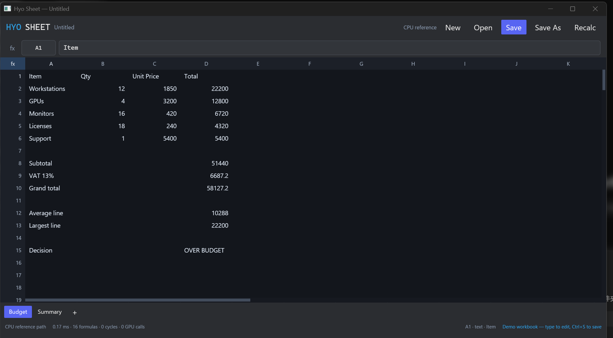

# Hyo Office

**Hyo Sheet** 是 Hyo Office 套件的第一个模块：用纯 Rust 实现的 Excel 兼容电子表格，UI 基于 iced + wgpu（Vulkan），数值内核可通过 NVIDIA cuda-oxide 在 GPU 上执行。



> 说明：你的需求里写的是 “wpu”；这里按 **wgpu** 实现。应用启动时会把 `WGPU_BACKEND` 设为 `vulkan`（如果外部没有显式覆盖），因此 iced 的 wgpu renderer 优先走 Vulkan。

## 当前完成度

这是一个可运行的纵向切片，不是完整的 Excel 替代品：

| 模块 | 状态 |
| --- | --- |
| 单元格/工作表/多 Sheet | ✅ 稀疏存储、A1 引用、跨 Sheet 引用、绝对引用 |
| 公式引擎 | ✅ 词法/语法分析、依赖图、拓扑重算、循环检测（#CIRC!） |
| Excel 数值语义 | ✅ f64、15 位有效数字显示、Excel 错误值、`ROUND` 十进制舍入 |
| 常用函数 | ✅ SUM/AVERAGE/MIN/MAX/COUNT/COUNTA/COUNTBLANK/PRODUCT/SUMPRODUCT、IF/IFERROR/IFNA/AND/OR/NOT、ABS/SQRT/POWER/MOD/ROUND/ROUNDUP/ROUNDDOWN/INT/TRUNC/LOG/LOG10/EXP、SIN/COS/TAN/ASIN/ACOS/ATAN/ATAN2、LEFT/RIGHT/MID/LEN/UPPER/LOWER/TRIM/REPT/EXACT/CONCAT/VALUE、IS* 系列 |
| XLSX 读写 | ✅ 基于 calamine + rust_xlsxwriter；公式、缓存值、多 Sheet 往返 |
| iced UI | ✅ 虚拟化画布网格、冻结行列头、公式栏、Sheet 标签、状态栏、键盘编辑、滚轮滚动 |
| wgpu / Vulkan | ✅ 启动强制 `WGPU_BACKEND=vulkan`，构建时只启用 iced 的 wgpu renderer |
| cuda-oxide GPU | 🟡 完整 kernel + C ABI + 动态加载 + CPU fallback 已实现；本机是 Windows，cuda-oxide 官方要求 Linux + CUDA 13 + 固定 nightly，因此本次运行验证的是 CPU fallback |
| 样式/图表/透视表/宏/数组公式 | ❌ 未实现（后续里程碑） |

## 快速开始

```bash
cargo run -p hyo-app
```

首次启动会打开一个带公式的示例工作簿（Budget / Summary）。可以直接输入覆盖单元格：

- 点击单元格选中
- 直接键入内容开始编辑；`Enter` 提交并下移，`Esc` 取消
- `F2` 编辑当前单元格
- 方向键 / Tab / PageUp / PageDown / Home / End 导航
- `Delete` 清空
- `Ctrl+S` 保存，`Ctrl+Shift+S` 另存为，`Ctrl+O` 打开，`Ctrl+N` 新建，`Ctrl+R` 重算

打开/保存使用系统文件对话框（`rfd`）；也支持命令行直接打开：

```bash
cargo run -p hyo-app -- fixtures/excel-golden.xlsx
```

## 架构

```text
crates/
  hyo-core/   纯 Rust 引擎：地址、值、公式 AST、求值器、依赖图、重算
  hyo-gpu/    NumericBackend 抽象、CPU 参考实现、CUDA 插件动态加载、阈值调度
  hyo-io/     XLSX 导入/导出
  hyo-app/    iced 应用、虚拟化网格 canvas、公式栏、Sheet 标签
gpu/
  hyo-cuda-oxide/   独立 workspace：cuda-oxide SIMT kernels + C ABI + 自测
fixtures/
  excel-golden.xlsx / .tsv   由真实 Microsoft Excel 生成的 46 个公式基准
```

### 数值兼容性

- 单元格和公式全部使用 `f64`，与 Excel 的二进制双精度存储一致。
- 显示最多 15 位有效数字；`1/3` 显示为 `0.333333333333333`，`0.1+0.2` 显示为 `0.3`。Excel 默认 General 格式通常只显示 10 位有效数字（列宽足够时 `1/3` 显示 `0.333333333`），Hyo Sheet 选择显示完整的二进制64存储精度；两者存储的数值一致。
- `ROUND(2.675,2) = 2.68`、`ROUND(-2.675,2) = -2.68` 这类十进制舍入陷阱已按 Excel 语义处理，而不是直接 `(x*100).round()`。
- Excel 的 `2^3^2 = 64`（左结合）、`-2^2 = 4`（一元负号优先于幂）也已对齐。
- `fixtures/excel-golden.tsv` 由本机 Microsoft Excel 365 生成；`cargo test -p hyo-io --test excel_golden` 会加载同一工作簿、用 Hyo 引擎重算并逐项比较。数值容差为相对 `1e-12`（远小于 Excel 15 位显示精度）。
- 反向也验证过：Hyo 导出的 `fixtures/hyo-sample.xlsx` 能被 Microsoft Excel 正常打开并重算，`=SUM(A1:A2)`、`=ROUND(2.675,2)`、`=IF(...)` 等结果一致。

运行全套测试：

```bash
cargo test --workspace
```

Linux 上需给 iced 开启 `x11` / `wayland` feature（Windows 默认不需要）。

### GPU / cuda-oxide

设计上分两层，避免让 Windows 的稳定构建依赖 cuda-oxide 的 Linux nightly：

1. **`gpu/hyo-cuda-oxide`**：独立的 cuda-oxide crate，包含 `range_stats` 和 `dot_product` 两个 f64 kernel，用共享内存做 block 内树形归约，输出每 block 的 partial，host 侧只做少量 partial 合并。它编译为 `cdylib` 并导出稳定的 C ABI。
2. **`crates/hyo-gpu`**：稳定 Rust。按 `HYO_GPU_THRESHOLD`（默认 65,536 个单元格）决定走 CPU 还是插件；通过 `libloading` 加载插件；任何加载/设备/内核错误都回退 CPU，不会显示脏结果。

构建 GPU 插件（Linux + CUDA 13 + Clang 21 + `nightly-2026-10-11`）：

```bash
cd gpu/hyo-cuda-oxide
cargo oxide doctor
cargo oxide build --release
export HYO_CUDA_LIBRARY="$PWD/target/release/libhyo_cuda_oxide.so"
cd ../..
cargo run -p hyo-app --features cuda-oxide
```

详见 [`gpu/hyo-cuda-oxide/README.md`](gpu/hyo-cuda-oxide/README.md)。

CPU/插件吞吐对比：

```bash
cargo run -p hyo-gpu --example bench --release
```

GPU 只在较大范围上占优：一次聚合需要 H2D + kernel + D2H，低于阈值的范围走 CPU 更快，也避免桌面 UI 抖动。

> 本机环境说明：当前机器是 Windows 11，cuda-oxide 官方要求 Linux（见其 README 的 Requirements），WSL 在此会话中不可访问。因此本次只能编译并运行 CPU 路径；cuda-oxide 源码已按上游 API 写好，但尚未在本机 GPU 上做端到端计时。这是一个明确的环境限制，不是“假装 GPU 已运行”。

## Excel 兼容范围

已覆盖：算术/比较/字符串连接、引用与区域、跨 Sheet、聚合、条件函数、文本函数、常用数学函数、Excel 错误值、循环引用标记。

未覆盖（会在后续版本补齐）：

- 日期/时间格式与序列值显示（XLSX 读入时日期按 Excel serial number 保留）
- 数组公式、动态数组、隐式交集、结构化引用、命名区域
- 单元格样式/数字格式/条件格式/合并单元格
- 图表、透视表、数据验证、批注、宏
- 撤销/重做、剪贴板、查找替换、冻结窗格、列宽拖拽

## 路线图

1. **Excel 打磨**：数字格式、日期、样式、复制粘贴、撤销栈、列宽/行高、冻结窗格、更多函数。
2. **GPU 批处理**：把一次重算中多个独立聚合打包成一批上传/下发，降低小范围调度开销；加入 GPU 侧有序求和/补偿求和选项。
3. **Word**：共享文本/排版/分页 crate，先做 DOCX 打开、编辑、导出 PDF。
4. **PowerPoint**：共享矢量画布与主题系统，先做 PPTX 打开、幻灯片编辑、放映。
5. **套件壳**：统一文件模型、最近文件、跨模块剪贴板、插件/扩展。

## 开发说明

本机 cargo 使用 `scripts/cargo-local.ps1` 包装器，把 crates.io 指向 `tools/crates_proxy.py`（当前 Windows 会话的 Schannel TLS 无法建立凭据）。这是环境 workaround，不属于产品代码；正常机器直接 `cargo` 即可。

```bash
# 本机
powershell -ExecutionPolicy Bypass -File scripts\cargo-local.ps1 test --workspace

# 重新生成 Excel 基准（需要本机 Excel + COM）
powershell.exe -Sta -ExecutionPolicy Bypass -File scripts\make-excel-golden.ps1
```

## License

Apache-2.0。见 [LICENSE](LICENSE)。
